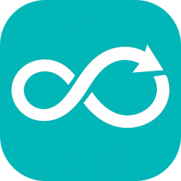

# Agentuino – Agentic coding for Arduino beginners

Agentuino brings agentic coding into the **Arduino IDE 2.x**. You describe in a chat what your Arduino should do. An AI agent works directly in your sketch folder: it writes the code, compiles it, fixes its own errors and can even read what your board prints on the serial port. No copy and paste, no extra windows.

Agentuino drives the command line agents **Claude Code**, **Mistral Vibe** and **Codex CLI** (experimental). It is the little sibling of [AI.duino](https://github.com/NikolaiRadke/AI.duino): no API keys, no feature menus, only the chat.

*Englisch? Kein Problem: Agentuino spricht Deutsch, sobald deine Arduino IDE auf Deutsch eingestellt ist.*

> [!IMPORTANT]
> Agentuino is a **beta**. It is tested on Linux with Claude Code and Mistral Vibe. Windows, macOS and Codex CLI are untested so far, feedback is very welcome!

🆕 What's new?
* **13.11.2026** **V0.8.0**: the agent debugs your sketch with ArduDebug.
* **13.11.2026** **V0.7.0**: rule blocks for your code rules.
* **12.11.2026** First public beta **V0.6.0**.
    -- More news? Check the [newsblog](NEWS.md).

## Features

### Every sketch is a project
Like a project in Claude: several chats per sketch share your instructions, knowledge files and a project memory. The agent can look up earlier chats when you refer to them. Everything lives in a folder `agentuino/` inside your sketch.

### The agent compiles and fixes
After every task that changed code, Agentuino compiles the sketch itself and shows the result: ✅ with flash and RAM usage, or ❌ with the errors. On errors the agent gets the compiler output and fixes the code on its own, up to three runs per task. A missing library is never installed without your ok.

### Undo with one click
Before every task Agentuino saves the code. ↶ next to your message brings back the state before that task, including files the agent created or deleted. The agent is told about the reset.

### Serial output for the agent
The agent can read what your board prints with `Serial.println()` for a few seconds and check whether the sketch really does what it should.

### Debugging with ArduDebug
With [ArduDebug](https://github.com/NikolaiRadke/ArduDebug) installed, the agent can stop your sketch on the board at a line and look into the variables, without changing the code. It asks before it uploads a debug build and brings the normal sketch back when the bug is fixed.

### Semantic anchors
Switch code rules on with a click, per sketch: beginner-friendly comments, no magic numbers, non-blocking code, save RAM, interrupt-safe and more. Create your own anchors for rules you need again and again. New sketches start with your default selection.

### Safe by default
The agent **never uploads on its own**, because a board can drive motors or relays. It installs libraries and board packages only after asking.

### More
- Attach files to a message, e.g. a photo of your breadboard or a datasheet
- Input history with ↑ / ↓
- German and English, following the IDE language
- Agent options are kept up to date with a configuration file from this repository. Agentuino asks before it downloads a new one.

## Requirements

- Arduino IDE 2.x (Linux, Windows or macOS)
- One agent, installed and logged in:

| Agent | Install | Note |
|---|---|---|
| [Claude Code](https://code.claude.com) | `curl -fsSL https://claude.ai/install.sh \| bash` (Windows: `irm https://claude.ai/install.ps1 \| iex`) | Claude subscription or API account |
| [Mistral Vibe](https://docs.mistral.ai/vibe) | `curl -LsSf https://mistral.ai/vibe/install.sh \| bash` (Windows: `uv tool install mistral-vibe`) | Version 3 or newer |
| [Codex CLI](https://github.com/openai/codex) | `npm install -g @openai/codex` | Experimental, ChatGPT account |

If no agent is found, the chat shows these commands and checks again after you installed one.

> [!NOTE]
> The agents are not free: they use your subscription or API account. The chat shows the cost of the current chat when the agent reports it.

## Installation

1. Download `agentuino-<version>.zip` from the [latest release](https://github.com/NikolaiRadke/Agentuino/releases/latest) and unpack it.
2. Run the installer in it:

#### Linux
```
chmod +x install_agentuino_linux.sh
./install_agentuino_linux.sh
```

#### macOS (untested)
```
chmod +x install_agentuino_macos.sh
./install_agentuino_macos.sh
```

#### Windows (untested)
Run `install_agentuino_windows.bat`.

3. Restart the Arduino IDE.

Agentuino checks for new versions at startup and shows a notice with a link to the release.

## Usage

- Click **Agentuino** in the status bar or press `Ctrl+Alt+A`. The chat opens next to your code.
- Describe what your Arduino should do, e.g. *"Let the LED blink faster when I press the button on pin 2."*
- The chat title opens the list of all chats of this sketch, **+ New** starts a new one.
- **⚙** opens the project instructions, semantic anchors, knowledge files, project memory, agent selection, language and the about page.

### The project folder

```
MySketch/
├── MySketch.ino
└── agentuino/
    ├── AGENTS.md    # your instructions + an automatic section (board, commands, rules)
    ├── memory.md    # what the agent learned about this project
    ├── knowledge/   # datasheets, pinouts, notes the agent may read
    ├── chats/       # one .json and one readable .md per chat
    ├── attachments/ # files attached to messages
    ├── backups/     # the saved code for ↶
    └── config.json  # project settings
```

The folder is created with the first chat message. Your sketch works without it.

## Security

By default the agent runs with full permissions (`agentuino.permissionMode` = `bypassPermissions`): it can edit files and run commands in your user account without asking, which compiling needs. The rules in `AGENTS.md` keep it inside the sketch folder, but they are instructions, not a sandbox. See [SECURITY.md](SECURITY.md).

## Settings

| Setting | Description |
|---|---|
| `agentuino.language` | UI language (`auto`, `de`, `en`) |
| `agentuino.agent` | Agent for new chats: `auto`, `claudecode`, `codex`, `vibe` |
| `agentuino.compileCheck` | Compile after every task that changed code (default on) |
| `agentuino.permissionMode` | `bypassPermissions` (default), `acceptEdits` or `auto` |
| `agentuino.claudePath` / `codexPath` / `vibePath` | Agent path, empty = auto-detect |
| `agentuino.claudeModel` / `codexModel` / `vibeModel` | Model, empty = agent default |
| `agentuino.checkForUpdates` | Check for new versions and agent configurations at startup; nothing is stored without asking (default on) |
| `agentuino.arduinoCliPath` | Path to arduino-cli, empty = the one bundled with the IDE |

## Uninstall

⚙ → *Uninstall Agentuino* removes the extension, its settings and the downloaded agent configuration. The `agentuino/` folders in your sketches are kept; delete them by hand if you don't need them anymore.

## For maintainers

Before publishing a changed `agentuino/extension/config/agentConfigs.json`, check it against the installed agents. Every option must appear in their help text:

```
node .github/scripts/check-agent-configs.js [--codex=<path>] [--vibe=<path>]
```

`.github/scripts/package.sh` builds the VSIX and the release zip into `dist/`.

## Content

```
├── agentuino/     The extension (VSIX content)
├── installer/     Installer scripts, the release zip adds the VSIX
└── .github/       Funding, maintenance scripts
```

## Related projects

- [AI.duino](https://github.com/NikolaiRadke/AI.duino) – the big sibling with many AI providers and features
- [ArduDebug](https://github.com/NikolaiRadke/ArduDebug) – breakpoint debugging for AVR boards in the Arduino IDE; Agentuino uses it for debugging by the agent

## 💙 Support Agentuino

Agentuino is free and open source. If you like it, a coffee keeps it going:

[](https://ko-fi.com/nikolairadke)
[](https://github.com/sponsors/NikolaiRadke)

## License

Apache License 2.0, © 2026 Monster Maker
